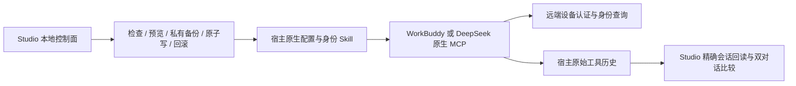

# 原生 MCP 接入与身份治理

本能力把原生接入整改抽象为可预览、可回滚、可复核的宿主适配器。首批支持 macOS WorkBuddy 5.9.3、DeepSeek Harness 0.2.2-rc.1；版本不匹配时停止写入。入口位于管理台「MCP → 原生 MCP 接入与身份治理」。

## 身份与权限

| 维度 | 来源 | 判据 |
|---|---|---|
| 设备 | 服务端将既有设备 key 映射为 device | registered=true，双对话设备一致 |
| Agent | 原生 MCP initialize 的 clientInfo | WorkBuddy / DeepSeek Harness；source=client_info |
| 当前对话 | 宿主运行时 | 两个真实对话分别现取 ID，不能由管理工具生成 |
| 项目 | 远端 project_resolve_identity | canonical repository_key 原样传入，matched 且位于授权项目名单 |
| 任务 | session_binding_get 的显式会话参数 | 项目、指纹、当前会话一致；unbound 合法，不自动创建或绑定 |

设备 key 是认证依据；clientInfo 是客户端自报信息，不是独立的密码学认证，不能据此扩大授权。Studio 自身仓库的授权/任务归属与所选验收项目分开处理。



控制面不实现 MCP 网络客户端，不用终端代连，不触发 Hook、桥接、worker 或旧队列。CLI 原生分支在通用审计/探测前返回；既有通用管理台的端点探测不属于原生验收证据。

## 宿主适配

**WorkBuddy**：连接键使用 `WorkBuddy`，从而保留其原生 Agent 名称。5.9.3 不按根 env 声明替换 Authorization，因此只在明确 apply 且缺失有效 Header 时内部解析既有安全凭据，写入 0600 配置；输出不含凭据。已有有效 Header 原样保留。信任操作走宿主正常面板，不修改信任账本。当前会话 ID 由原生 Skill 加载时替换 `${CODEBUDDY_SESSION_ID}`，普通文件读取不算证明。

**DeepSeek**：主配置为 `~/.dsh/profiles/desktop/cordis.patch.yml`，识别 `insert` 及禁用父节点。保留原生 HTTP 插件、Cordis 表达式和原有 Header。当前固定版本使用外置原生插件适配副本，仅替换 clientInfo.name；9 个依赖引用回原 App 的同一模块实例，避免重复加载 scope 状态。原 App ASAR 不修改，不复制依赖、不运行桥接、不构建第三方源码。适配前校验原始入口 SHA-256，保存补丁清单；未知基线停止。当前会话 ID 只允许原生终端读取一个非凭据变量 `DSH_SESSION_ID`，终端不连接 MCP。

宿主配置、Skill、补丁副本及私有回执纳入修复；其他插件与配置保留。已合规原生插件可直接采用。通用 `--fix-mcp` 对注册的这两个原生适配器只提示使用专用入口，避免重新写入占位 Header 或重复连接。

## CLI 工作流

端点来自现有声明式端点库；不把地址或凭据写死在适配器中。以下 `<...>` 为用户选择的值。

```sh
python3 scan.py --native-identity --format json
python3 scan.py --native-plan workbuddy --native-endpoint <endpoint-key>
python3 scan.py --native-apply workbuddy --native-endpoint <endpoint-key> --native-if-match <plan-hash>
python3 scan.py --native-start workbuddy --native-endpoint <endpoint-key> --native-repository-key 'v1|git.example/team/repo|.'
python3 scan.py --native-capture <run-id> --native-slot A --native-session <host-current-id-A>
python3 scan.py --native-capture <run-id> --native-slot B --native-session <host-current-id-B>
python3 scan.py --native-verify <run-id>
python3 scan.py --native-runs
python3 scan.py --native-show <run-id>
python3 scan.py --native-rollback <receipt-id>
```

DeepSeek 的宿主参数为 `deepseek-harness`。apply 需要匹配最新计划，`--dry-run` 不写入。GUI 使用相同 CLI、先预览再确认；不自动重启。需重载时等待宿主全部活动对话结束，再由正常宿主入口重载。

本地状态目录为 `~/.local/share/skill-mcp-studio/native-mcp`（0700），回执与备份为 0600。备份可能含原配置，禁止将备份或原始聊天历史提交 Git。回滚先检查全部受影响文件的修复后哈希，遇到后续编辑拒绝覆盖。

## 双对话验收

1. 创建 run，得到 A/B 两份带随机 challenge 的指令。run ID 仅用于关联验收，不能当作聊天 ID。
2. 在目标宿主建立两个独立真实对话，各自加载专用 Skill、现取自身原生 ID，仅调用 auth_check、project_resolve_identity、session_binding_get 三项只读原生 MCP 工具。
3. 将宿主返回的 ID 作为精确历史选择器。WorkBuddy 读取对应 JSONL，DeepSeek 读取对应 zstd JSONL（需要已安装 zstd；支持 Homebrew 的 Finder 启动路径）。不扫描“最近对话”推断当前 ID。
4. 核验原生 session header、当前 challenge、真实 callId/result 配对、原生命名空间、设备、clientInfo、授权项目与绑定参数。模型最终回答、手工导入 JSON、旧 challenge 或错误工具回执不能替代原始证据。
5. verify 再次回读两个源文件；配置或应用版本改变则要求重新验收。比较相同设备、相同 Agent、相同项目和不同原生 ID，保存最小字段与原始结果哈希，不复制 token、Header 或完整聊天正文。

**不主张**：所有通用 MCP 调用都会自动携带对话 ID；当前验收证明的是显式 `native_session_id` 参数正确到达远端。读取到 `unbound` 不能说明历史上从未绑定。一次验收不证明未来应用升级、凭据撤销后仍有效。

## 扩展新 Agent

为新宿主增加版本/安装证据、原生配置定位、clientInfo 适配、凭据能力、当前会话 ID 来源、信任/重载要求和原始工具历史解析器。先补错误版本、缺失凭据、并发编辑、伪造摘要、相同 ID、错误设备/项目、旧 challenge 的拒绝用例，再进行两个真实对话验收。缺少可靠当前会话来源时报告 unsupported，不能退回目录名、时间戳、随机 UUID、旧 Hook 或桥接。

本能力依据本轮《Agent 原生 MCP 身份能力规范》实现；实际运行证据见 [双对话验收报告](reviews/2026-11-06-native-mcp-identity-acceptance.md)。
